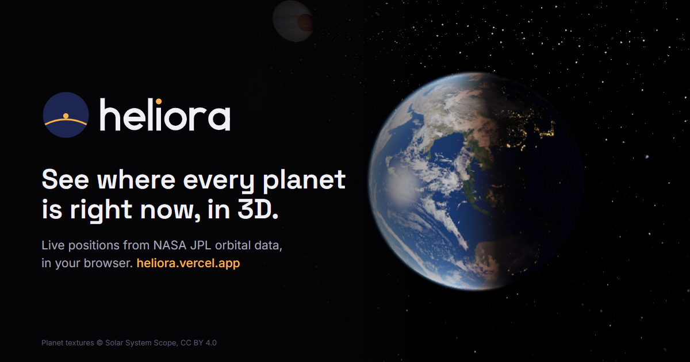

<h1>
  <picture>
    <source media="(prefers-color-scheme: dark)" srcset="brand/logo/heliora-horizontal-dark.svg">
    
  </picture>
</h1>

**See where every planet is right now, in 3D.** Heliora is a live model of the solar system that runs in your browser. Every planet sits where it really is on today's date, computed from NASA JPL orbital elements. Run time forward or backward, fly to any world, and watch Earth turn with real day and night.

**Live:** [heliora.vercel.app](https://heliora.vercel.app)



Real-time graphics, real data, shipped: one TypeScript engine, one shader file, an orbit model checked against published almanacs. Built with React, Vite and Three.js r184.

## Features

- **Live by default.** Opens on the real configuration for the current date and time, with a Live indicator.
- **Time controls.** Pause, real time, ±1 hour/day/week/month/year per second, and a Now button. The clock stops at 1800 and 2050, the validity range of the JPL table, instead of drifting into wrong positions.
- **Two ways to look.** A scroll-driven **Tour** from the Sun outward, and a free **Explore** mode: drag to orbit, scroll or pinch to zoom, click a planet, label or list entry to fly to it, or pull back to the whole system.
- **Live readouts.** Distance from the Sun and from Earth, and how long sunlight takes to arrive, for the date shown.
- **Earth.** Day and night from the real Sun direction, city lights past the terminator, ocean glint, cloud shadows, and rotation driven by sidereal time.
- **Atmospheres.** A small single-scattering ray march for Venus, Earth, Mars and the giant planets, lit by the same Sun direction as the surface.
- **Saturn.** Rings shade the planet, and the planet shades the rings.
- **The Moon.** Real phase and distance, tidally locked so the near side faces Earth.
- **Sun.** Animated granulation, limb darkening and a streamer corona, with HDR bloom that only catches the Sun and bright glints.
- **Sky.** A Milky Way panorama in its true galactic orientation, plus 7,000 point stars.
- **Asteroid belt.** 5,000 bodies on Keplerian orbits evaluated in the vertex shader, with the Kirkwood gaps left open.
- **Axial tilts** from IAU pole coordinates for every body.
- Responsive: side panels on desktop, bottom sheet on phones. Honors `prefers-reduced-motion`.

## How accurate is it?

Positions use JPL's *Approximate Positions of the Planets* (Table 1, valid 1800–2050), solved in the browser every frame. As a check, the model puts Jupiter's opposition on 11 February 2027 and Mars's on 19 February 2027, matching published almanacs, and Earth's perihelion around 4 January 2027.

Two things are deliberately **not** to scale:
- **Distances from the Sun** are compressed with a power curve so the outer planets are visible. Directions are real.
- **Planet sizes** are enlarged for display.

The Moon uses a short lunar theory (main terms only), so its position can be off by a degree or two. This is a visual model, not an ephemeris: for observing or precise work, use [JPL Horizons](https://ssd.jpl.nasa.gov/horizons/).

## Run

```bash
npm install
npm run dev      # http://localhost:3000
npm run build    # production build in dist/
```

## Deploy

Import the repository in Vercel; it detects Vite and needs no extra settings. Enable **Analytics** in the project dashboard (the script is already wired for production builds). If the site ends up on a domain other than `heliora.vercel.app`, update the canonical URL and Open Graph tags in `index.html`, plus `public/robots.txt` and `public/sitemap.xml`.

## Code map

- `src/lib/orbits.ts`: JPL elements, Kepler solver, Moon theory, sidereal time
- `src/three/engine.ts`: renderer, post-processing, bodies, camera rig, picking, labels, time loop
- `src/three/shaders.ts`: GLSL for the Sun, corona, planets, Earth, clouds, atmosphere, rings, stars, belt and orbit trails
- `src/three/scale.ts`: distance compression and ecliptic → scene transforms
- `src/lib/planetData.ts`: body data, tour sections, poles, atmospheres
- `src/lib/simStore.ts`: shared state between the React UI and the render loop
- `src/components/`: navigation, tour panel, explore panel, time controls, credits

## Brand and marketing

The logo, icons, link preview image and usage rules live in [`brand/`](brand/README.md). Positioning, the launch plan and the SEO audit live in [`marketing/`](marketing/) (written in Indonesian).

## Credits

- Planet, Moon and Milky Way textures © [Solar System Scope](https://www.solarsystemscope.com/textures/), licensed [CC BY 4.0](https://creativecommons.org/licenses/by/4.0/).
- Orbital elements: [NASA JPL Solar System Dynamics](https://ssd.jpl.nasa.gov/planets/approx_pos.html).
- Pole coordinates: IAU Working Group on Cartographic Coordinates and Rotational Elements.

## License

Code is released under the [MIT License](LICENSE). The textures in `public/textures/` are third-party works under CC BY 4.0 and keep their own license and attribution.
